<!-- Images in /assets are generated by assets/build.py (light and dark versions) -->

<picture>
  <source media="(prefers-color-scheme: dark)" srcset="assets/hero-dark.svg" />
  
</picture>

## About me

I'm doing a Master's in **AI & Data Engineering** at the **University of Pisa**, the same university where I got my **B.Sc. in Computer Engineering** in 2025.

What I enjoy most is the point where data, models and systems meet: training a model and then figuring out *why* it decides what it decides, running jobs on data that doesn't fit on one machine, getting small devices to talk to each other. Most of my projects were team work, and the part I like best is taking an idea from paper to something that actually runs.

<picture>
  <source media="(prefers-color-scheme: dark)" srcset="assets/skyline-dark.svg" />
  
</picture>

## Outside of code

<!-- Placeholder: replace with real hobbies and passions -->
- **Puzzles**: mechanical puzzles such as the Rubik's cube, I enjoy challenge my own mind
- **Sports**: I've played footbal since child and enjoy all kinds of sports
- **Manga/Anime**: I'm passionate about this culture

## What I work with

| | |
|---|---|
| **Languages** |        |
| **Data & ML** |      |
| **Big Data & Cloud** |    |
| **Back end** |    |
| **Databases & Monitoring** |      |
| **Tools** |    |

## Projects

**Master's degree**

<a href="https://github.com/LeonardoLentini/employee-promotion-prediction"><picture>
  <source media="(prefers-color-scheme: dark)" srcset="assets/project-employee-promotion-dark.svg" />
  
</picture></a>
<a href="https://github.com/LeonardoLentini/Internet-of-Things-Project"><picture>
  <source media="(prefers-color-scheme: dark)" srcset="assets/project-smart-battery-dark.svg" />
  
</picture></a>

<a href="https://github.com/LeonardoLentini/love-mining"><picture>
  <source media="(prefers-color-scheme: dark)" srcset="assets/project-love-mining-dark.svg" />
  
</picture></a>
<a href="https://github.com/LeonardoLentini/cloud-computing-mapreduce-spark"><picture>
  <source media="(prefers-color-scheme: dark)" srcset="assets/project-director-actor-dark.svg" />
  
</picture></a>

**Bachelor's degree**

<a href="https://github.com/LeonardoLentini/escape-room-tcp"><picture>
  <source media="(prefers-color-scheme: dark)" srcset="assets/project-escape-room-dark.svg" />
  
</picture></a>
<a href="https://github.com/LeonardoLentini/laureandosi"><picture>
  <source media="(prefers-color-scheme: dark)" srcset="assets/project-laureandosi-dark.svg" />
  
</picture></a>

<a href="https://github.com/LeonardoLentini/filmsphere-db"><picture>
  <source media="(prefers-color-scheme: dark)" srcset="assets/project-filmsphere-dark.svg" />
  
</picture></a>
<a href="https://github.com/LeonardoLentini/prato-fiorito"><picture>
  <source media="(prefers-color-scheme: dark)" srcset="assets/project-prato-fiorito-dark.svg" />
  
</picture></a>

## Contacts

<a href="https://www.linkedin.com/in/leonardo-lentini-33490b323/"><picture>
  <source media="(prefers-color-scheme: dark)" srcset="assets/button-linkedin-dark.svg" />
  
</picture></a>
<a href="mailto:leonardo.lentini2@gmail.com"><picture>
  <source media="(prefers-color-scheme: dark)" srcset="assets/button-email-dark.svg" />
  
</picture></a>

<picture>
  <source media="(prefers-color-scheme: dark)" srcset="assets/footer-dark.svg" />
  
</picture>
